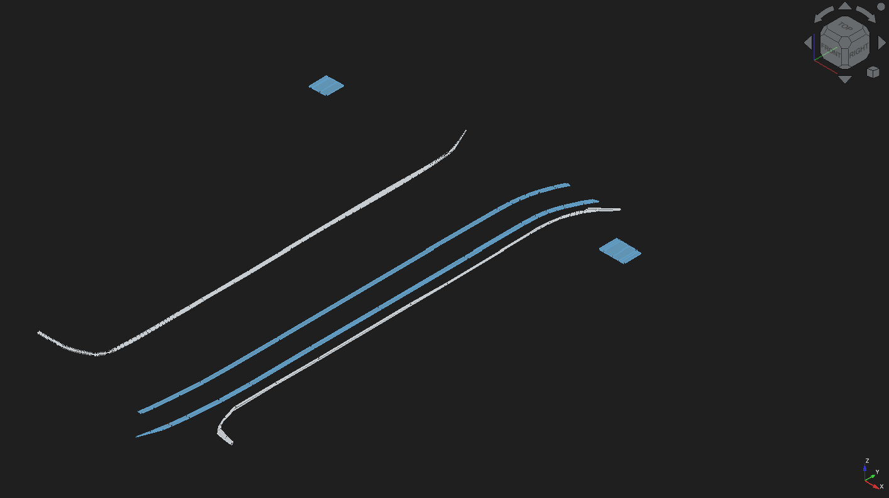
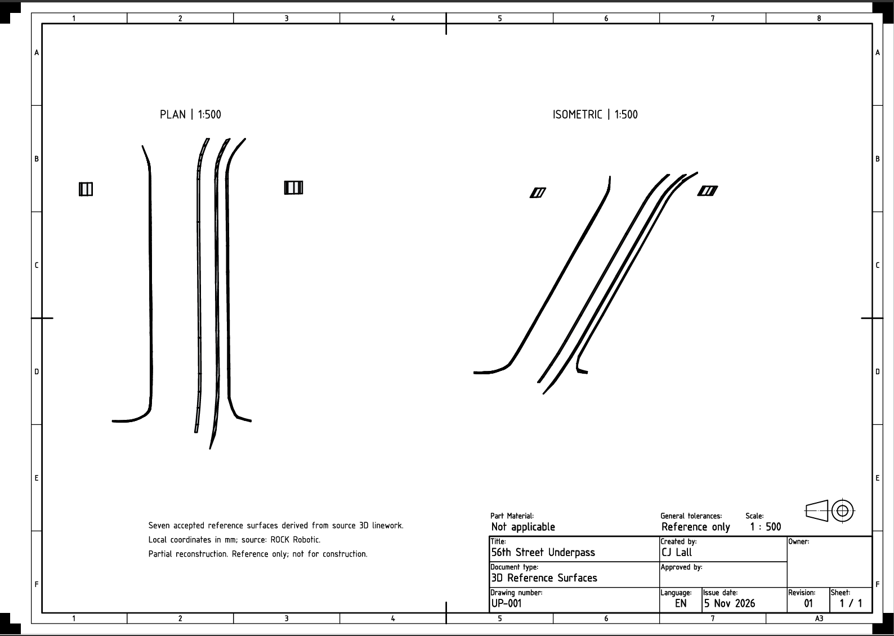
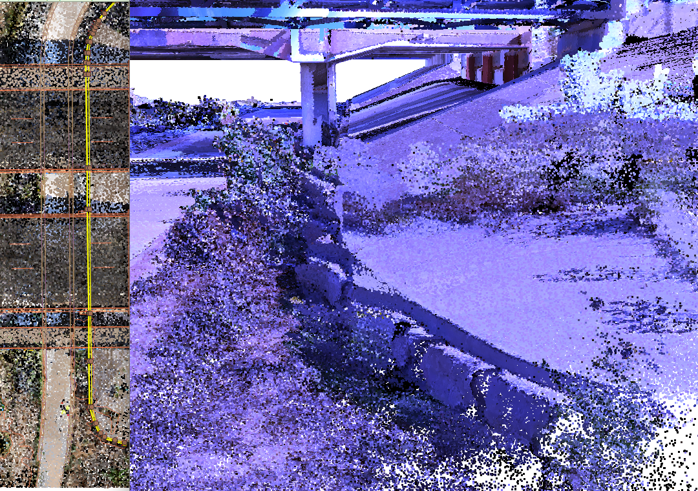
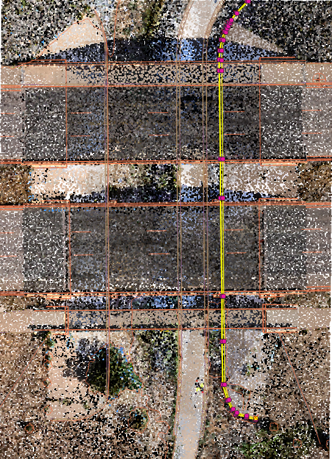
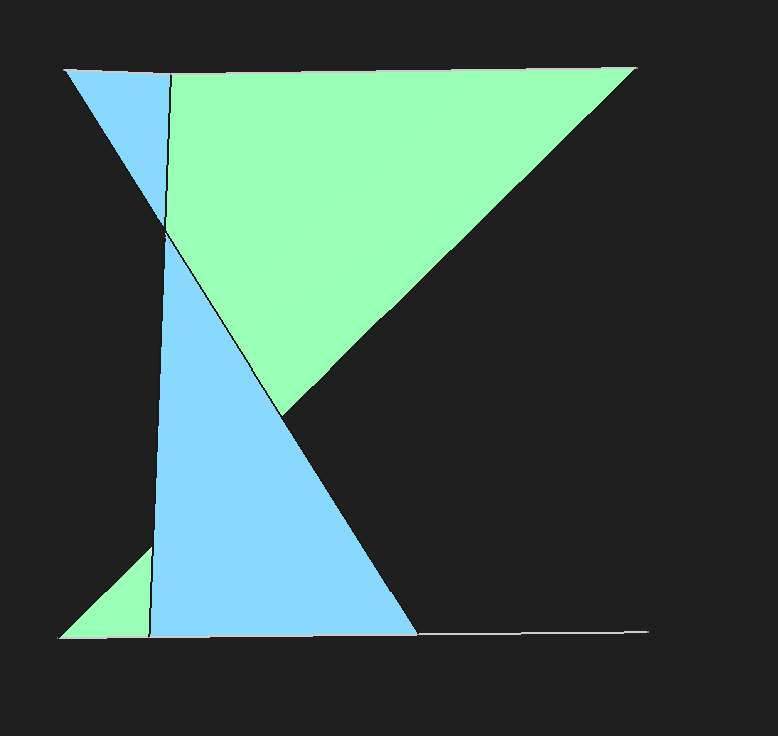
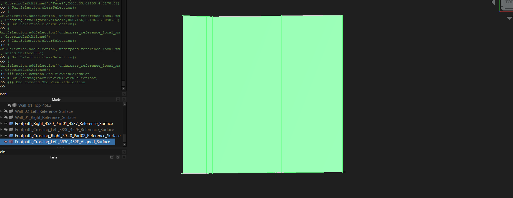

# 56th Street Underpass — GIS-to-CAD Reconstruction

Reconstructed seven 3D reference surfaces from supplied survey linework, using QGIS to inspect boundaries against LiDAR and FreeCAD to build and validate wall and footpath geometry. The finished package includes an editable CAD model, an A3 technical drawing, and traceable reference data.

*Plan and isometric reference drawing at 1:500. Click the drawing to open the PDF.*

## Deliverables

| Deliverable | Contents |
| --- | --- |
| [Technical drawing](deliverables/56th_Street_Underpass_Reference_Surfaces.pdf) | A3 sheet with plan and isometric views at 1:500, scope notes, and project identification |
| [FreeCAD model](cad/underpass_model.FCStd) | Seven accepted reference surfaces, retained source boundaries, and superseded geometry organized into groups |
| [QGIS project](56th_street_underpass/underpass.qgz) | Spatial inspection workspace for point-cloud context, source linework, and reference preparation |
| [GeoPackage](56th_street_underpass/underpass.gpkg) | Project vector layers and coordinate-preparation checkpoints |
| [Local-coordinate DXF](56th_street_underpass/processed/underpass_reference_local_mm.dxf) | Selected 3D linework translated and converted to local millimeters |
| [Reference lookup](56th_street_underpass/processed/cad_reference_lookup.csv) | Source identifiers and coordinates supporting CAD object traceability |
| [FreeCAD labeling macro](56th_street_underpass/processed/label_cad_references.FCMacro) | Geometry-based matching that restores descriptive labels after DXF import |

## Project objective

Turn georeferenced 3D linework into a focused, reviewable CAD reference model while preserving elevations and source identity. The work addresses common interoperability problems: inconsistent CRS metadata, large survey coordinates, lost feature labels, and incorrect correspondence between surface boundaries.

The accepted model contains three wall surfaces, two longitudinal footpath surfaces, and two footpath crossing surfaces. Reconstruction was limited to supported boundary pairs; missing connections were left unresolved.

## Source inspection and coordinate preparation

QGIS provided the spatial context for identifying wall and footpath boundaries using source attributes, plan views, and the combined aerial/SLAM point cloud. Selected vertex inspection helped confirm boundary correspondence and endpoints before CAD construction.

The source point cloud contained inconsistent CRS metadata. Assigning the appropriate predefined horizontal CRS in QGIS restored alignment; this corrected the interpretation of coordinates without rewriting the original source file.

| Coordinate reference | Definition |
| --- | --- |
| Source horizontal CRS | NAD83(2011) / Colorado Central (ftUS), EPSG:6428 |
| Source vertical reference | NAVD88 height (ftUS), EPSG:6360 |
| Local origin, source units | X = 3,174,680; Y = 1,716,140; Z = 5,230 |
| CAD coordinates | Local X, Y, Z in millimeters |
| Conversion | Local coordinate = (source coordinate − origin) × 304.800609601219 |

The conversion uses the US survey foot. Source elevations were retained relative to the local Z origin. Local CAD coordinates are an engineering coordinate frame; inherited GIS CRS metadata on intermediate layers does not make those millimeter values georeferenced survey coordinates.

## CAD traceability and automation

The selected subset contained 17 source features, producing 18 imported CAD objects because one feature was multipart. DXF import did not retain the descriptive feature labels.

A Python FreeCAD macro matched complete vertex sequences against the reference lookup, accounting for reversed vertex order. It checked for unique matches before applying labels and preserved the geometry. The 0.02 mm matching tolerance handled coordinate representation differences; it is not a statement of survey accuracy.

## Geometry QA and repair

Validation combined FreeCAD shape checks with visual inspection of boundary correspondence and end connections. This distinction mattered: a surface could pass `isValid()` while still connecting the wrong portions of its boundaries.

The initial crossing surfaces showed crossed, bow-tie geometry. Changing ruled-surface orientation improved shape validity but did not resolve the spatial mismatch.

The affected surfaces were rebuilt using shared coordinate stations over the overlapping boundary interval. Intermediate points were interpolated along existing source segments, then corresponding segment pairs were joined into surface panels. Crossing repairs used X stations; the left longitudinal footpath used Y stations.

The resulting accepted surfaces passed shape-validity checks and were inspected individually. Superseded crossing surfaces were retained separately for traceability. The right longitudinal footpath, which had already passed inspection, remained accepted.

## Results and scope

- Seven accepted 3D reference surfaces with identifiable source boundaries.
- Repaired boundary correspondence on affected footpath surfaces.
- Editable CAD model and a consistent plan/isometric drawing package.
- Documented coordinate conversion and automated restoration of source labels.

This is a partial reference-surface reconstruction, not a complete bridge or solid infrastructure model. Surface panels interpolate between supplied boundaries; they do not represent a fitted LiDAR mesh. No wall thickness, foundations, or missing middle connections were inferred. Outputs are for reference and portfolio demonstration, not construction or certified survey use.

## Opening the project

Open `cad/underpass_model.FCStd` in FreeCAD or use the PDF for immediate review. The model was prepared in FreeCAD 1.1.4.

Open `56th_street_underpass/underpass.qgz` in QGIS for the spatial workspace. Large LAZ/LAS point clouds are excluded from Git; obtain the source dataset separately and reconnect any unavailable layers. The processed point-cloud clip can be regenerated from the source using the saved project boundary.

## Data attribution

Source data: ROCK Robotic's public **56th Street Underpass — SLAM + Aerial Combined** dataset, including supplied 3D linework and point-cloud context. Data collection was performed by the source provider; this project covers inspection, preparation, reconstruction, QA, automation, and presentation.

- [ROCK Robotic dataset overview](https://www.rockrobotic.com/articles/56th-street-underpass-slam-aerial-combined/)
- [Source dataset viewer](https://cloud.rockrobotic.com/share/43c1f114-018f-4083-941f-4d03468989b2)

**Tools:** QGIS · FreeCAD · Python · Git
